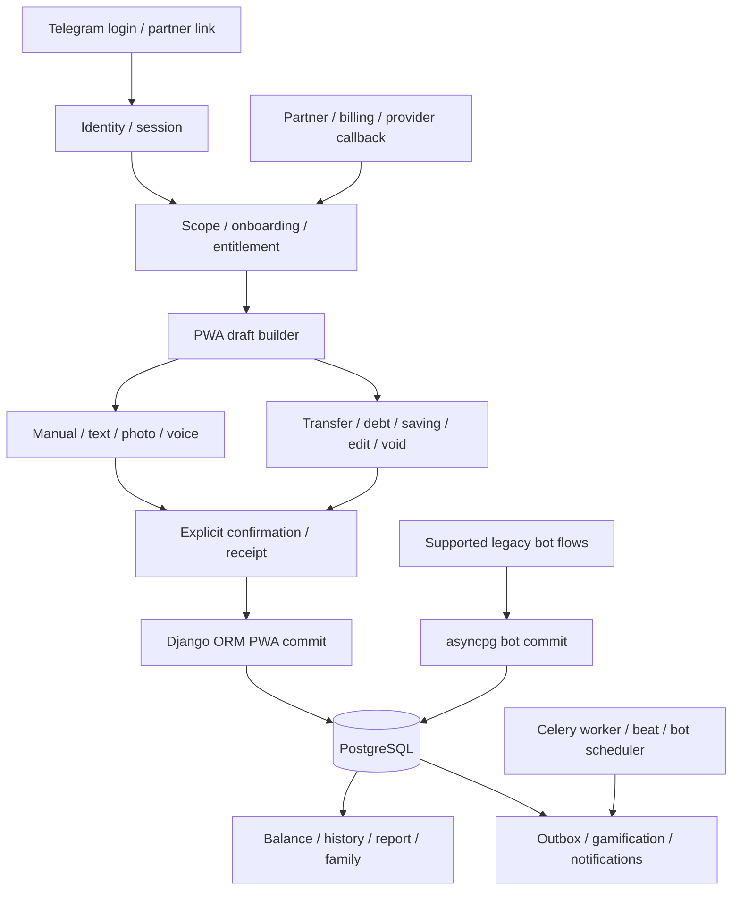

# Карта сценаріїв, впливу та приймання

[Dashboard](README.md) · [Реєстр](register.json) · [План](ROADMAP.md)

Початкова risk/impact map, не повна формальна специфікація. Стрілка — залежність, не доведений end-to-end результат. Потрібні продуктові рішення не приймаються самим фактом створення цієї карти.

Два commit-path — факт; поведінкова розбіжність — ризик до characterization. Support policy Telegram і архітектуру domain seam ще не змінено.

## Контрольні інваріанти

- **INV-CONFIRM:** Жодного фінансового запису до явного підтвердження користувачем.
- **INV-ONCE:** Retry/replay/подвійне підтвердження не створюють другого фінансового ефекту.
- **INV-ATOMIC:** Фінансова mutation і баланс узгоджені; невдача не залишає часткового переказу.
- **INV-FX:** Cross-currency transfer потребує введеного курсу з явним напрямком та округленням.
- **INV-TRANSFER:** Переказ не є витратою чи доходом.
- **INV-SCOPE:** Personal/family доступ і право зміни перевіряються на сервері.
- **INV-ACCESS:** Entitlement визначається погодженим контрактом, не рекламним текстом; невизначені правила не вигадуються.
- **INV-PWA:** PWA — основний інтерфейс; Telegram capabilities потребують явного support policy.
- **INV-RELEASE:** Merged, deployed, runtime-verified, functionally-accepted та owner-accepted — різні твердження.

## Матриця приймання

`UNVERIFIED` означає, що цей аудит не виконав названий user journey. Це не твердження, що сценарій несправний або ніколи не тестувався. Source anchors — початок трасування, не доказ повного acceptance.

### FLOW-AUTH. Вхід і повернення після Telegram login

- **Інваріанти:** INV-SCOPE, INV-PWA
- **Назване приймання:** Новий/існуючий користувач; протермінований/replayed login; правильний return route.
- **Статус:** `unverified` у межах аудиту.
- **Source anchors:** `admin_service/miniapp/urls.py:11`

### FLOW-ONBOARD. Онбординг, категорії та початкові залишки

- **Інваріанти:** INV-CONFIRM, INV-SCOPE
- **Назване приймання:** Draft/cancel/confirm, дата навколо midnight; повторний confirm; категорії обов’язкові.
- **Статус:** `unverified` у межах аудиту.
- **Source anchors:** `admin_service/miniapp/onboarding.py:175`

### FLOW-ACCESS. Доступ, trial, partner і картка

- **Інваріанти:** INV-ACCESS, INV-PWA
- **Назване приймання:** Organic/course/partner, cardless/pending/confirmed, existing/paid/family; очікування trial/card потребує рішення.
- **Статус:** `unverified` у межах аудиту.
- **Source anchors:** `admin_service/miniapp/services.py:556`

### FLOW-TX. Звичайна витрата/дохід

- **Інваріанти:** INV-CONFIRM, INV-ONCE, INV-ATOMIC, INV-SCOPE
- **Назване приймання:** PWA draft→confirm→balance/history/report, cancel/replay; зіставити з bot writer.
- **Статус:** `unverified` у межах аудиту.
- **Source anchors:** `admin_service/miniapp/services.py:1592`

### FLOW-ACCOUNT. Створення/зміна рахунку

- **Інваріанти:** INV-CONFIRM, INV-ONCE, INV-SCOPE
- **Назване приймання:** Draft/confirm/cancel, початковий баланс, повтор і доступ до чужого scope.
- **Статус:** `unverified` у межах аудиту.
- **Source anchors:** `admin_service/miniapp/services.py:1962`

### FLOW-TRANSFER. Переказ і валютний курс

- **Інваріанти:** INV-CONFIRM, INV-ONCE, INV-ATOMIC, INV-FX, INV-TRANSFER
- **Назване приймання:** Same/cross-currency, напрямок/rounding, atomic rollback, replay, report exclusion.
- **Статус:** `unverified` у межах аудиту.
- **Source anchors:** `admin_service/miniapp/services.py:2245`

### FLOW-DEBT. Борг і погашення

- **Інваріанти:** INV-CONFIRM, INV-ONCE, INV-ATOMIC, INV-SCOPE
- **Назване приймання:** Видача/отримання/погашення, часткова сума, cancel/replay, фінансові side effects.
- **Статус:** `unverified` у межах аудиту.
- **Source anchors:** `admin_service/miniapp/services.py:2530`

### FLOW-HISTORY. Історія, редагування та скасування

- **Інваріанти:** INV-CONFIRM, INV-ONCE, INV-ATOMIC, INV-SCOPE
- **Назване приймання:** Edit/void, баланс і звіт після виправлення, member/owner, double submit.
- **Статус:** `unverified` у межах аудиту.
- **Source anchors:** `admin_service/miniapp/history.py:507`

### FLOW-FAMILY. Сім’я та межі доступу

- **Інваріанти:** INV-SCOPE, INV-ACCESS
- **Назване приймання:** Owner/member × personal/family × read/create/edit/void; invite/leave/revoke.
- **Статус:** `unverified` у межах аудиту.
- **Source anchors:** `admin_service/miniapp/urls.py:74`

### FLOW-REPORT. Звіти й агрегати

- **Інваріанти:** INV-TRANSFER, INV-SCOPE
- **Назване приймання:** Правильні періоди/валюта, transfer exclusion, edit/void, personal/family, timezone.
- **Статус:** `unverified` у межах аудиту.
- **Source anchors:** `admin_service/miniapp/urls.py:117`

### FLOW-TEXT. Розпізнавання тексту

- **Інваріанти:** INV-CONFIRM, INV-ONCE
- **Назване приймання:** Parse→editable draft→confirm; provider failure не пише DB; ручний fallback.
- **Статус:** `unverified` у межах аудиту.
- **Source anchors:** `admin_service/miniapp/urls.py:83`

### FLOW-PHOTO. Фото/чек, review і batch

- **Інваріанти:** INV-CONFIRM, INV-ONCE
- **Назване приймання:** Upload→recognize→review/edit→confirm→DB; batch/cancel/retry/низька якість.
- **Статус:** `unverified` у межах аудиту.
- **Source anchors:** `admin_service/miniapp/urls.py:85`

### FLOW-VOICE. Голос і транскрипція

- **Інваріанти:** INV-CONFIRM, INV-ONCE
- **Назване приймання:** Permission/upload→STT→draft→confirm; timeout/неоднозначна сума/cancel.
- **Статус:** `unverified` у межах аудиту.
- **Source anchors:** `admin_service/miniapp/urls.py:84`

### FLOW-SAVING. Накопичення та saving tasks

- **Інваріанти:** INV-CONFIRM, INV-ONCE, INV-SCOPE
- **Назване приймання:** Draft/confirm/cancel; scope; узгодити financial vs planning effects.
- **Статус:** `unverified` у межах аудиту.
- **Source anchors:** `admin_service/miniapp/savings_tasks.py:222`

### FLOW-CAPTURE. Автозахоплення з пристрою

- **Інваріанти:** INV-CONFIRM, INV-ONCE, INV-SCOPE
- **Назване приймання:** Pair→physical purchase→inbox→review→confirm; offline/lock/restart/revoke. Device acceptance не виконаний.
- **Статус:** `unverified` у межах аудиту.
- **Source anchors:** `admin_service/miniapp/urls.py:51`

### FLOW-BILLING. Підписка, callback та поновлення

- **Інваріанти:** INV-ACCESS, INV-ONCE
- **Назване приймання:** Provider callback replay/decline/pending, bind/cancel/renew, відсутність downgrade; real PSP окремо.
- **Статус:** `unverified` у межах аудиту.
- **Source anchors:** `admin_service/miniapp/urls.py:70`

### FLOW-NOTIFY. Сповіщення й фонові задачі

- **Інваріанти:** INV-SCOPE, INV-ACCESS
- **Назване приймання:** Права/consent, доставка/retry/revoke, worker/beat; не дублювати фінансовий ефект.
- **Статус:** `unverified` у межах аудиту.
- **Source anchors:** `admin_service/miniapp/urls.py:60`

### FLOW-DELETE. Видалення облікового запису

- **Інваріанти:** INV-CONFIRM, INV-SCOPE
- **Назване приймання:** Preflight→explicit confirm; особисті/сімейні наслідки; не виконувати на справжніх даних.
- **Статус:** `unverified` у межах аудиту.
- **Source anchors:** `admin_service/miniapp/urls.py:41`

## Impact правила

| Змінюємо | Перевіряємо sibling flows | Критичний guard |
|---|---|---|
| Transaction commit | FLOW-HISTORY, FLOW-REPORT, FLOW-FAMILY, FLOW-NOTIFY | no write before confirm, idempotency, scope |
| Transfer/FX | FLOW-ACCOUNT, FLOW-REPORT, FLOW-HISTORY | debit/credit atomic, explicit FX, not expense/income |
| Access/billing | FLOW-AUTH, FLOW-ONBOARD, FLOW-FAMILY, FLOW-CAPTURE | no entitlement downgrade, callback replay |
| Recognition modality | FLOW-TX, FLOW-HISTORY, FLOW-ACCOUNT | editable draft, cancel/retry without mutation |
| Date/period | FLOW-ONBOARD, FLOW-REPORT | application timezone and period boundaries |
| Config/jobs | FLOW-NOTIFY та конкретні affected flows | names-only contract, startup/queue dependencies |

Вибрати FLOW та узгоджений контракт; назвати impacted INV/siblings; виконати named acceptance на exact candidate; окремо показати passed/skipped/blocked. Список файлів — підказка, не повна модель впливу.

## Наявні тести як стартова точка

- `admin_service/miniapp/tests_mini_confirmation_postgres.py` та `bot/tests/test_financial_postgres_acceptance.py`: characterization на isolated PostgreSQL.
- `admin_service/miniapp/tests_mini_confirmation_integrity.py`: orchestration guards, не рівнозначні реальному commit/provider.
- `bot/tests/test_transaction_service.py`, `bot/tests/test_manual_transfer_rate_regression.py`: domain/FX guards, доповнити cross-channel DB matrix.

Ці файли тут не запускали. Факт існування — не green acceptance. Перші slices: HEALTH-05, HEALTH-06, HEALTH-07, HEALTH-08. Inventory маршрути/config names ще потребує FLOW/owner mapping (HEALTH-04/HEALTH-12).
